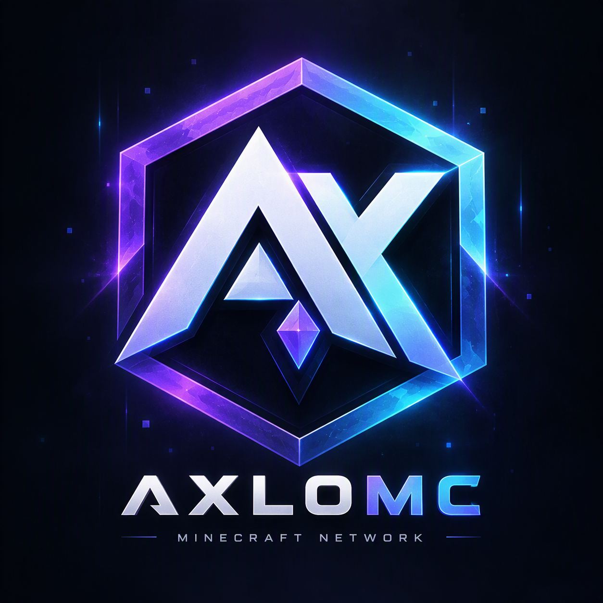

<<div align="center">



# AXLOMC

### A next-our legacy.**

<br>

![Website](https://img.shields.io/badge/Website-In%nt-667CFF?style=for-the-badge
![Network](https://img.shields.io/badge/Network-ComingDFF?style=for-the-badge
![Minecraft](https://img.shields.io/badge/Minecraft-Javaock-50E2A1?style=for-the-badge
![License](https://img.shields.io/badge/License-All%20Rights-A36CFF?style=for-the-badge

</div>

---

## About AxloMC

AxloMC is a next-generation Minecraft network focused on fair gameplay, meaningful progression, competitive experiences, and an active global community.

The network is currently in development. The official server address, supported versions, Discord community, and launch date will be announced before release.

## Planned Game Modes

### BedWars

Protect your bed, gather resources, upgrade your team, and eliminate every opponent.

- Solo and team modes
- Player levels and statistics
- Daily and weekly quests
- Seasonal progression
- Cosmetic rewards

### SkyWars

Loot floating islands, choose your strategy, and become the final surviving player.

- Competitive maps
- Fast-paced combat
- Player statistics
- Seasonal rewards
- Progression challenges

### Duels

Challenge other players in fast competitive matches across multiple combat modes.

- Ranked matchmaking
- Multiple duel kits
- Private matches
- Detailed match history
- Competitive leaderboards

### Survival

Explore, build, trade, and create a lasting community in a balanced survival experience.

- Land protection
- Player economy
- Trading systems
- Community events
- Long-term progression

## AX Economy

**AX** is the primary gameplay currency of AxloMC.

Players will be able to earn AX through:

- Playing games
- Winning matches
- Completing quests
- Unlocking achievements
- Claiming daily rewards
- Participating in community events

```text
PLAY -> EARN AX -> UNLOCK COSMETICS
